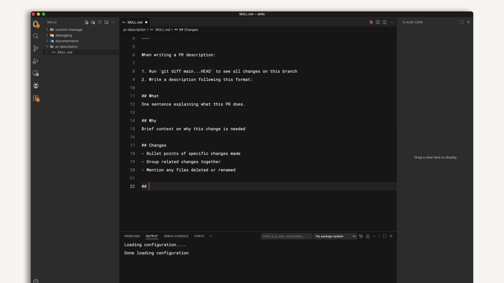
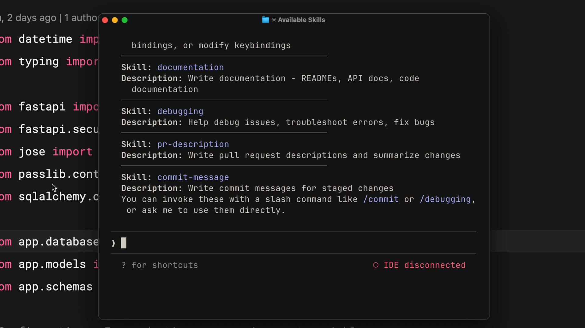
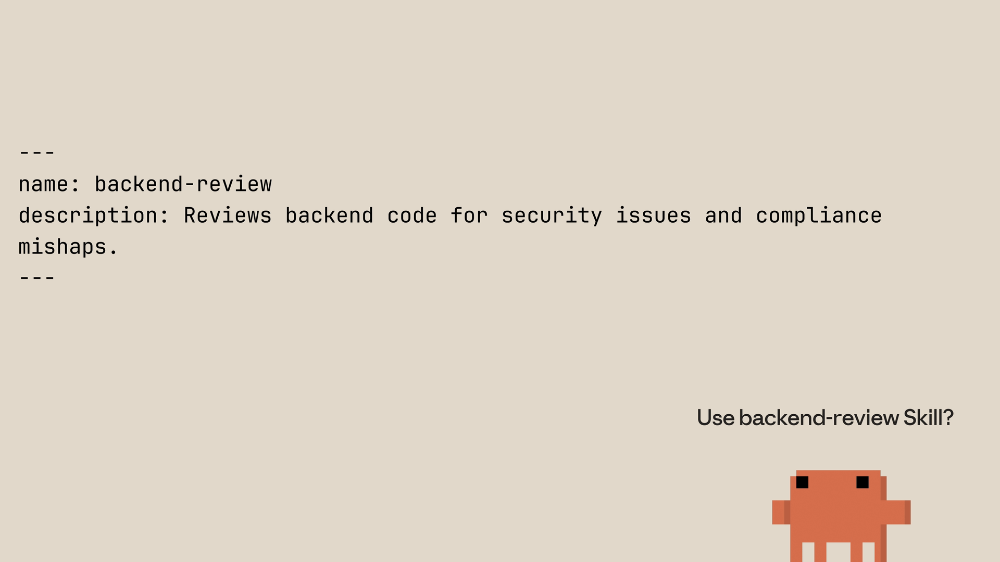

# Example: Make Claude write PR descriptions the same way every time

## The problem

Every time you ask Claude to write a pull request description, you have to explain the format again. You want a "What", a "Why", and a "Changes" section, and you want Claude to check the branch diff first. Explaining this again and again wastes time, and the output still changes from one PR to the next.

You want to write the instructions once, and have Claude use them whenever you ask for a PR description.

## The solution

Create a personal skill called `pr-description`. A skill is a folder with a `SKILL.md` file. The file tells Claude when to use the skill and what to do. Because the skill is in your home folder, it works in every project.

## Steps

### Step 1: Create the skill folder

Make a folder inside `~/.claude/skills/`. The folder name must match the skill name.

```bash
mkdir -p ~/.claude/skills/pr-description
```

`~/.claude/skills/` is the personal location. On Windows, this is `C:/Users/<your-user>/.claude/skills`.

### Step 2: Write `SKILL.md`

Create a file called `SKILL.md` inside the folder. The file has two parts.

- **Top part (frontmatter):** between two lines of `---`. It holds the `name` and the `description`.
- **Bottom part (body):** the instructions Claude follows.

`~/.claude/skills/pr-description/SKILL.md`:

```markdown
---
name: pr-description
description: Writes pull request descriptions. Use when creating a PR, writing a PR, or when the user asks to summarize changes for a pull request.
---

When writing a PR description:

1. Run `git diff main...HEAD` to see all changes on this branch.
2. Write the description in this format:

## What
One sentence on what this PR does.

## Why
Short context on why the change is needed.

## Changes
- Specific changes, grouped by related work
- Any files deleted or renamed
```



The `description` is important. Claude reads it to decide when to use the skill. If the description says "Use when creating a PR", then a request like "write a PR description" will match it.

### Step 3: Restart Claude Code

Claude Code loads skills when it starts. After you create or change a skill, close the session and start it again.

### Step 4: Check that the skill is listed

In Claude Code, type `/skills`. You should see `pr-description` in the list with its description.



If it is not there, check three things:
- The folder is in `~/.claude/skills/`.
- The file is named exactly `SKILL.md`, in capital letters.
- The frontmatter has `name` and `description`, between two `---` lines.

### Step 5: Test it

1. Create a branch and make a small change.
2. Ask Claude: "write a PR description for my changes."
3. Claude asks you to confirm loading the skill. Confirm.
4. Claude reads the full `SKILL.md`, runs `git diff main...HEAD`, and writes the description in the three-part format.

Run it again on another branch. The format should be the same.

### Step 6: Avoid name clashes

Skills with the same name are used in this order:

1. Enterprise (managed settings)
2. Personal (`~/.claude/skills`)
3. Project (`.claude/skills` in a repo)
4. Plugins

If two skills have the same name, the one higher in the list wins. Use specific names, such as `frontend-review` or `backend-review`, to avoid this.



### Step 7: Update or remove the skill

- To change the format, edit `SKILL.md`.
- To delete the skill, delete the whole `pr-description` folder.
- Restart Claude Code after either change.

## Summary

| Task | What to do |
|---|---|
| Create the skill | Make `~/.claude/skills/pr-description/SKILL.md` |
| Describe when to use it | Write a clear `description` |
| Describe what to do | Write the steps and format in the body |
| Apply the change | Restart Claude Code |
| Confirm it works | Run `/skills`, then ask for a PR description |

Once the skill is set up, you only have to ask "write a PR description for my changes." The format is the same every time.
